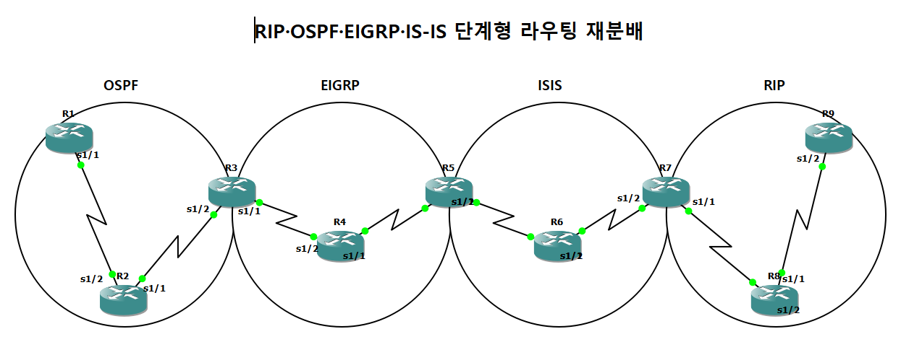
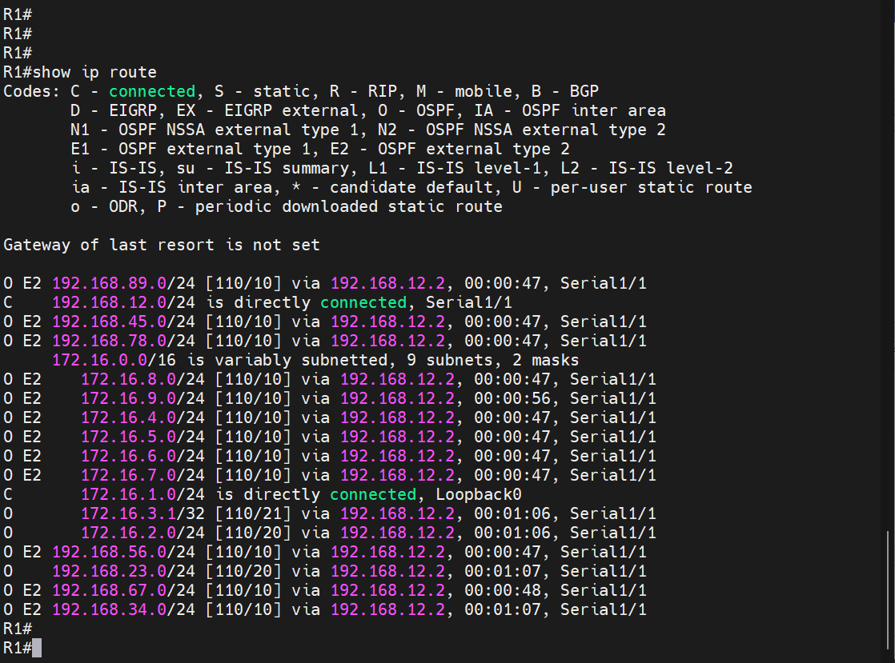
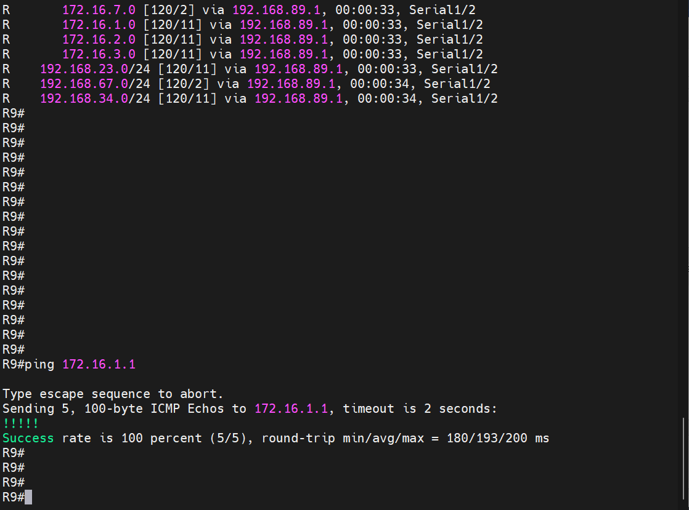

# RIP·OSPF·EIGRP·IS-IS 단계형 경로 재분배

| 항목 | 내용 |
|---|---|
| 프로젝트 | 20261016-1 |
| 실습일 | 2026-10-16 |
| 핵심 기술 | OSPF, EIGRP, IS-IS, RIP, 경로 재분배 |

인접한 두 프로토콜 구간의 경계 라우터가 서로의 경로를 재분배하여, 네 가지 프로토콜 구간이 한 줄로 연결된 구조에서 끝단 라우터 간 통신이 가능한지 확인한 실습입니다.

## 1. 구성과 목적

라우터 9대(R1~R9)를 직렬 링크로 연결하고, 구간마다 서로 다른 라우팅 프로토콜을 실행했습니다.

| 구간 | 라우터 | 프로토콜 |
|---|---|---|
| 1 | R1, R2, R3 | OSPF 100 (Area 0) |
| 2 | R3, R4, R5 | EIGRP 100 |
| 3 | R5, R6, R7 | IS-IS 100 |
| 4 | R7, R8, R9 | RIP |

R3(OSPF와 EIGRP), R5(EIGRP와 IS-IS), R7(IS-IS와 RIP)이 경계 라우터이며, 각 경계 라우터는 자신에게 인접한 두 프로토콜 사이에서만 재분배를 수행합니다. 이 실습의 목적은 경로가 프로토콜 구간을 한 단계씩 거쳐서 반대편 끝까지 전달되는지 확인하는 것입니다.



## 2. 주요 설정

설정 전체는 [부록 설정 발췌](../부록_설정발췌.md#01-단계형-경로-재분배-20261016-1)에 수록했습니다. 재분배와 관련된 핵심 줄은 다음과 같습니다.

```
! R3 (OSPF <-> EIGRP)
router eigrp 100
 redistribute ospf 100 metric 1544 20000 255 1 1500
router ospf 100
 redistribute eigrp 100 metric 10 subnets

! R5 (EIGRP <-> IS-IS)
router eigrp 100
 redistribute isis 100 level-1-2 metric 1554 20000 255 1 1500
router isis 100
 redistribute eigrp 100

! R7 (IS-IS <-> RIP)
router isis 100
 redistribute rip metric 10
router rip
 redistribute isis 100 level-2 metric 10
```

## 3. 동작 원리

재분배는 한 프로토콜이 학습한 경로를 다른 프로토콜의 경로로 변환하여 광고하는 기능입니다. 프로토콜마다 경로 비용(메트릭)의 형식이 다르므로, 재분배할 때 시드 메트릭을 직접 지정해야 합니다. EIGRP는 대역폭, 지연, 신뢰성, 부하, MTU를 함께 지정했고, OSPF와 RIP은 고정 비용 10을 지정했습니다. OSPF로 재분배한 외부 경로는 `subnets` 키워드가 있어야 서브넷 단위로 광고됩니다.

경계 라우터에서 경로가 재분배되면 라우팅 테이블의 프로토콜 표기가 바뀝니다. R1은 172.16.4.0/24부터 172.16.9.0/24까지 OSPF 외부 경로(`O E2`)로 학습했습니다. R3에서 172.16.4.0/24와 172.16.5.0/24는 EIGRP 내부 경로(`D`), 172.16.6.0/24부터 172.16.9.0/24까지는 EIGRP 외부 경로(`D EX`)로 표시됐습니다.

## 4. 검증 결과

| 확인 항목 | 장비와 명령어 | 결과 | 증빙 |
|---|---|---|---|
| OSPF 인접 관계 | R3 `show ip ospf neighbor` | R2(2.2.2.2)와 FULL 상태입니다. | [캡처](../assets/evidence/20261016-1/02_R3_show-ip-ospf-neighbor.png) |
| EIGRP 인접 관계 | R3 `show ip eigrp neighbors` | R4 방향 192.168.34.2와 인접 관계가 형성되었습니다. | [캡처](../assets/evidence/20261016-1/03_R3_show-ip-eigrp-neighbors.png) |
| IS-IS 인접 관계 | R5 `show isis neighbors` | R6와 L1L2 인접 관계가 UP 상태입니다. | [캡처](../assets/evidence/20261016-1/05_R5_show-isis-neighbors.png) |
| 재분배 경로 확인(OSPF 쪽) | R1 `show ip route` | 192.168.89.0, 172.16.4.0~172.16.9.0 등 먼 구간의 경로가 `O E2`로 학습되었습니다. | [캡처](../assets/evidence/20261016-1/01_R1_show-ip-route.png) |
| 재분배 경로 확인(EIGRP 쪽) | R3 `show ip route` | 172.16.4.0, 172.16.5.0은 `D`, 172.16.6.0~172.16.9.0은 `D EX`로 학습되었고 OSPF 경로는 `O`입니다. | [캡처](../assets/evidence/20261016-1/04_R3_show-ip-route.png) |
| 종단 통신 | R9 `ping 172.16.1.1` | 성공률 100%(5/5)입니다. | [캡처](../assets/evidence/20261016-1/09_R9_ping-172-16-1-1.png) |

R1과 R9은 서로 다른 끝에 위치하므로, 이 ping 성공은 네 구간의 재분배가 모두 정상적으로 이어졌음을 보여 줍니다.





---

[실습 요약](../실습요약.md) · [설정 발췌](../부록_설정발췌.md#01-단계형-경로-재분배-20261016-1) · [이 프로젝트의 전체 캡처](../전체증빙/증빙목록.md#20261016-1)
