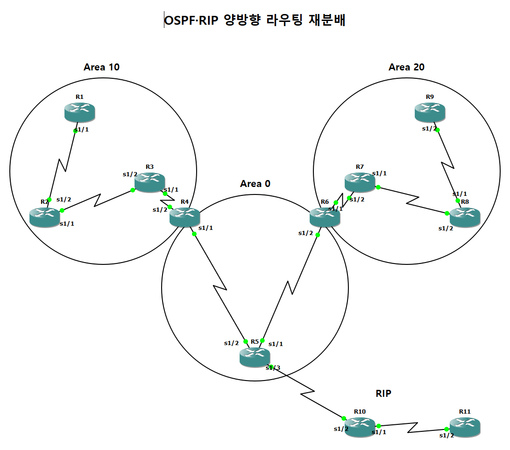
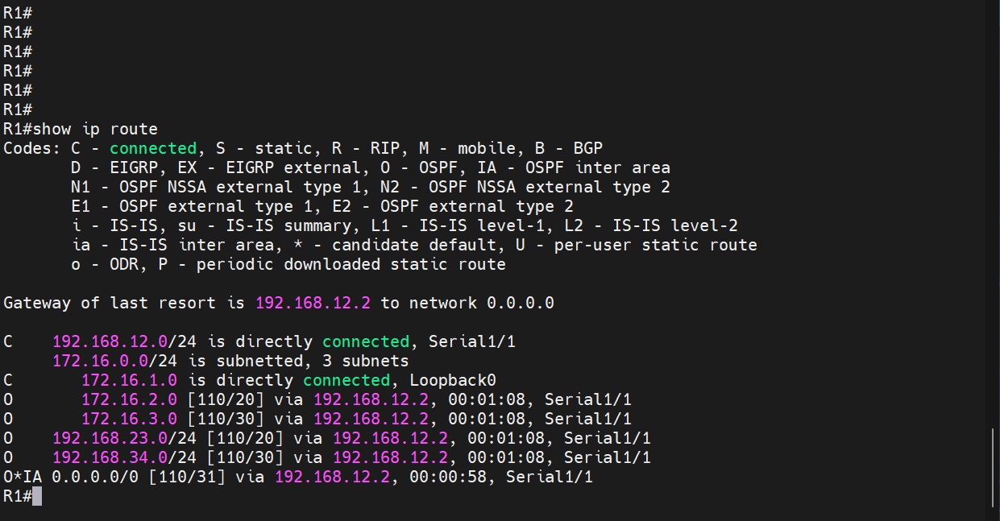
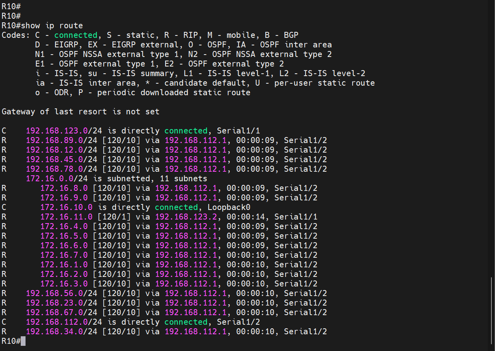

# OSPF 다중 Area와 RIP 양방향 재분배

| 항목 | 내용 |
|---|---|
| 프로젝트 | 20260827-2 |
| 실습일 | 2026-08-27 |
| 핵심 기술 | OSPF 다중 Area, Stub, Totally Stubby, RIP, 양방향 재분배 |

OSPF Area 0을 중심으로 Stub 계열 Area 두 개를 연결하고, Area 0의 R5 아래에 RIP 구간을 붙여 두 프로토콜 사이의 양방향 재분배와 Area 유형별 라우팅 테이블 차이를 확인한 실습입니다.

## 1. 구성과 목적

라우터 11대(R1부터 R11까지)를 사용했습니다. OSPF 구간은 R1부터 R9까지이고 RIP 구간은 R10, R11입니다.

| 구간 | 라우터 | 유형 |
|---|---|---|
| Area 10 | R1, R2, R3 (ABR: R4) | Stub (R4에서 `no-summary`를 지정하여 Totally Stubby로 동작) |
| Area 0 | R4, R5, R6 | 백본 |
| Area 20 | R7, R8, R9 (ABR: R6) | Stub (R6에서 `no-summary`를 지정하여 Totally Stubby로 동작) |
| RIP | R10, R11 | R5와 직렬 링크로 연결 |

R5가 OSPF와 RIP을 함께 실행하는 경계 라우터입니다. 이 실습의 목적은 두 가지입니다. 첫째, Stub과 Totally Stubby Area 안쪽 라우터의 라우팅 테이블이 어떻게 단순해지는지 확인합니다. 둘째, R5의 양방향 재분배로 RIP 구간과 OSPF 구간이 서로의 경로를 학습하는지 확인합니다.



## 2. 주요 설정

설정 전체는 [부록 설정 발췌](../부록_설정발췌.md#02-ospf-다중-area와-rip-재분배-20260827-2)에 수록했습니다.

```
! R4 (Area 10과 Area 0의 ABR)
router ospf 4
 area 10 stub no-summary
 network 192.168.34.0 0.0.0.255 area 10
 network 172.16.4.0 0.0.0.255 area 0
 network 192.168.45.0 0.0.0.255 area 0

! R5 (OSPF와 RIP의 경계)
router ospf 5
 redistribute rip metric 10 subnets
router rip
 redistribute ospf 5 metric 10
 network 192.168.112.0
```

## 3. 동작 원리

Stub Area에서는 외부 경로(Type 5 LSA)를 받지 않고, ABR이 기본 경로를 광고합니다. ABR에서 `no-summary`를 지정하면 다른 Area의 상세 경로를 나타내는 Type 3 LSA도 이 Area로 광고하지 않습니다. 따라서 Totally Stubby Area 내부에는 같은 Area의 경로와 ABR이 광고한 기본 경로가 함께 남습니다.

R5는 RIP에서 학습한 경로를 OSPF로, OSPF에서 학습한 경로를 RIP으로 각각 넘겨줍니다. RIP 쪽에는 `metric 10`을, OSPF 쪽에는 `metric 10 subnets`를 지정하여 시드 메트릭을 부여했습니다.

## 4. 검증 결과

| 확인 항목 | 장비와 명령어 | 결과 | 증빙 |
|---|---|---|---|
| Totally Stubby 동작 | R1 `show ip route` | Area 10 안쪽의 R1에는 Area 내부 경로와 `O*IA 0.0.0.0/0`(기본 경로)만 있고 RIP 구간이나 다른 Area의 상세 경로는 없습니다. | [캡처](../assets/evidence/20260827-2/01_R1_show-ip-route.png) |
| 경계 라우터 인접 관계 | R5 `show ip ospf neighbor` | OSPF 인접 관계 출력을 수록했습니다. | [캡처](../assets/evidence/20260827-2/02_R5_show-ip-ospf-neighbor.png) |
| 경계 라우터 경로 | R5 `show ip route` | RIP 경로(`R` 192.168.123.0, 172.16.10.0, 172.16.11.0)와 OSPF 경로(`O`, `O IA`)를 함께 가지고 있습니다. | [캡처](../assets/evidence/20260827-2/03_R5_show-ip-route.png) |
| OSPF → RIP 재분배 | R10 `show ip route` | OSPF 구간의 192.168.12.0, 172.16.1.0~172.16.9.0 등이 `R`로 학습되었습니다. | [캡처](../assets/evidence/20260827-2/04_R10_show-ip-route.png) |
| 종단 통신 | R11 `ping 172.16.1.1` | R11에서 Area 10의 R1까지 성공률 100%(5/5)입니다. | [캡처](../assets/evidence/20260827-2/06_R11_ping-172-16-1-1.png) |





---

[실습 요약](../실습요약.md) · [설정 발췌](../부록_설정발췌.md#02-ospf-다중-area와-rip-재분배-20260827-2) · [이 프로젝트의 전체 캡처](../전체증빙/증빙목록.md#20260827-2)
