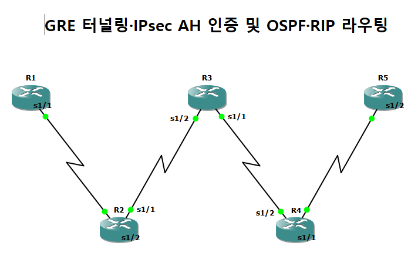
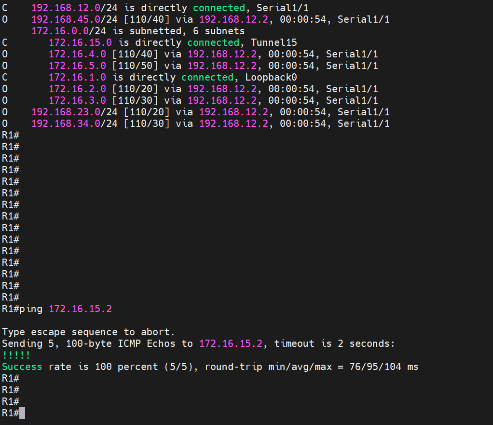
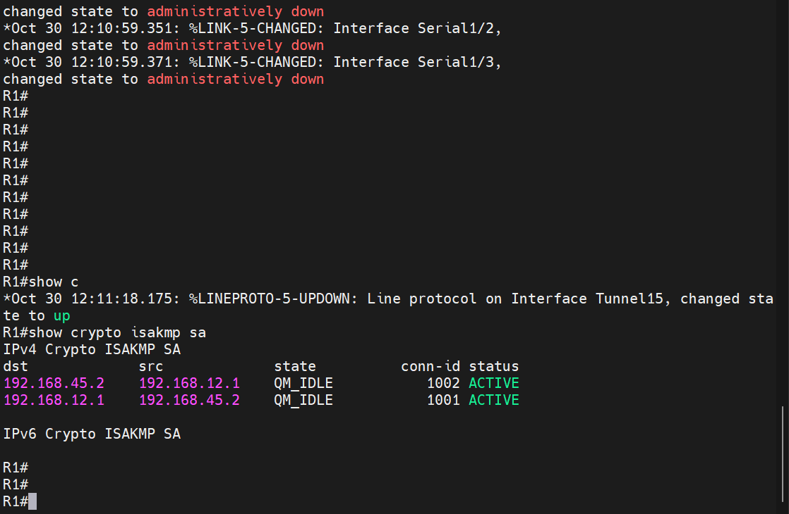
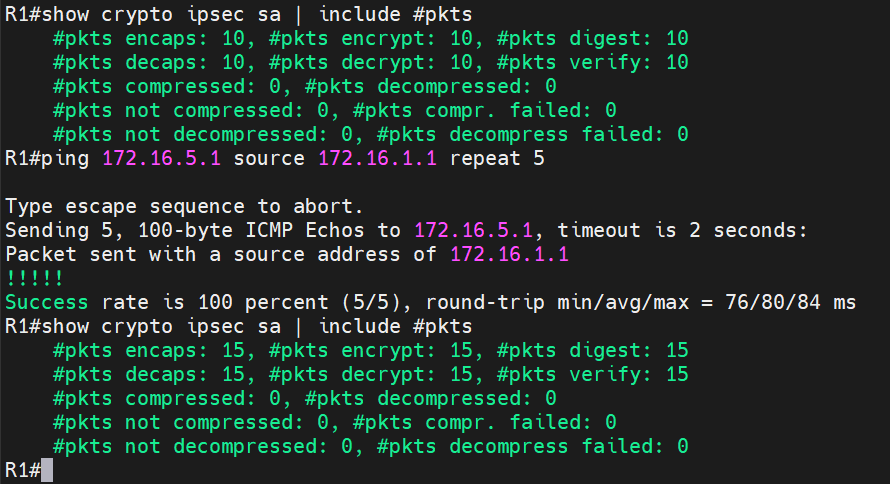

# GRE 터널과 IPsec(AH) 인증

| 항목 | 내용 |
|---|---|
| 프로젝트 | 20260831-2 |
| 실습일 | 2026-08-31 |
| 보완 검증일 | 2026-11-09 |
| 핵심 기술 | GRE, IPsec(AH, ah-md5-hmac), ISAKMP, OSPF, RIP |

OSPF로 연결된 라우터 5대 환경에서 양 끝 라우터 사이에 GRE 터널을 만들고, 터널 트래픽에 IPsec AH 인증을 적용하여 터널 위로 RIP 경로를 교환한 실습입니다.

## 1. 구성과 목적

R1부터 R5까지 라우터 5대를 직렬 링크로 한 줄로 연결했습니다. 물리 구간은 OSPF Area 0으로 라우팅하고, 양 끝의 R1(Serial1/1, 192.168.12.1)과 R5(Serial1/2, 192.168.45.2) 사이에 `Tunnel15`(172.16.15.0/24)를 구성했습니다. 터널 위에서는 RIP이 172.16.0.0/16 대역을 교환합니다. 터널로 전송되는 GRE 패킷에는 IPsec AH 인증을 적용했습니다.

이 실습의 목적은 GRE 터널의 동작과 IPsec(ISAKMP와 IPsec SA)의 협상 과정을 한 구성에서 함께 확인하는 것입니다.



## 2. 주요 설정

설정 전체는 [부록 설정 발췌](../부록_설정발췌.md#03-gre-터널과-ipsec-ah-인증-20260831-2)에 수록했습니다. 사전 공유 키 값은 발췌에서 제외했습니다.

```
! R1
crypto isakmp policy 10
 hash md5
 authentication pre-share
 group 2
 lifetime 60
crypto isakmp key <실습용 값> address 192.168.45.2
crypto ipsec transform-set KITRI ah-md5-hmac
crypto map VPN 10 ipsec-isakmp
 set peer 192.168.45.2
 set transform-set KITRI
 match address R1R5
interface Tunnel15
 ip address 172.16.15.1 255.255.255.0
 tunnel source Serial1/1
 tunnel destination 192.168.45.2
interface Serial1/1
 crypto map VPN
ip access-list extended R1R5
 permit gre 192.168.12.0 0.0.0.255 192.168.45.0 0.0.0.255
```

## 3. 동작 원리

GRE는 다른 프로토콜의 패킷을 IP 패킷 안에 담아 전달하는 터널링 방식입니다. GRE 자체에는 인증과 암호화가 없으므로, 물리 인터페이스(Serial1/1)에 적용한 crypto map이 GRE 패킷(ACL `R1R5`의 `permit gre`)을 IPsec으로 보호합니다.

IPsec은 두 단계로 협상합니다. 먼저 ISAKMP(IKE 1단계)가 라우터 사이의 인증과 키 교환 방식을 정하고(해시 MD5, 사전 공유 키, DH 그룹 2), 이어서 IPsec SA(2단계)가 실제 데이터 보호 방식을 정합니다. 이 실습의 transform-set은 `ah-md5-hmac`이므로 데이터에 AH(Authentication Header)가 적용됩니다. AH는 출처 인증과 무결성만 제공하며, 데이터를 암호화하지는 않습니다.

## 4. 검증 결과

| 확인 항목 | 장비와 명령어 | 결과 | 증빙 |
|---|---|---|---|
| 터널 인터페이스 상태 | R1 `show interface Tunnel15` | `Tunnel15 is up, line protocol is up`이며 GRE/IP 터널입니다. | [캡처](../assets/evidence/20260831-2/01_R1_show-interface-Tunnel15.png) |
| 터널 반대편 상태 | R5 `show interface Tunnel15` | R5에서도 터널 인터페이스 상태를 확인했습니다. | [캡처](../assets/evidence/20260831-2/03_R5_show-interface-Tunnel15.png) |
| 초기 라우팅 | R1 `show ip route` | `172.16.15.0/24`가 Tunnel15에 직접 연결되어 있고, 172.16.2.0~172.16.5.0은 OSPF(`O`)로 학습되었습니다. | [캡처](../assets/evidence/20260831-2/02_R1_show-ip-route.png) |
| IKE 협상 | R1 `show crypto isakmp sa` | 양방향 모두 `QM_IDLE`, `ACTIVE`입니다. | [캡처](../assets/evidence/20260831-2/06_R1_show-crypto-isakmp-sa.png) |
| IPsec SA | R1 `show crypto ipsec sa` | transform이 `ah-md5-hmac`인 AH SA가 `ACTIVE`로 확인됩니다. | [캡처 1](../assets/evidence/20260831-2/07_R1_show-crypto-ipsec-sa-p1of2.png), [캡처 2](../assets/evidence/20260831-2/08_R1_show-crypto-ipsec-sa-p2of2.png) |
| 터널 통신 | R1 `ping 172.16.15.2` | 성공률 100%(5/5)입니다. | [캡처](../assets/evidence/20260831-2/05_R1_ping-172-16-15-2.png) |





### 보완 검증

초기 시험에서 R1은 R5의 Loopback에 OSPF 직렬 경로를 사용했고, R5는 R1의 Loopback에 RIP 터널 경로를 사용했습니다. 강의 예제에 따라 R5의 OSPF에서 172.16.5.0/24 광고를 제거하고 물리 구간의 OSPF는 유지했습니다. 변경 후 R1도 RIP로 상대 Loopback 경로를 학습했고 Tunnel15를 선택했습니다. Loopback 간 ping은 5/5였고, 송신 encaps/digest 및 수신 decaps/verify는 각각 10에서 15로 증가했습니다. ah-md5-hmac SA가 ACTIVE 상태임을 확인한 뒤 R5의 설정을 저장했습니다.

[변경 전 R1 경로](../assets/evidence/20260831-2/09_R1_show-ip-route-before.png) · [변경 전 R5 경로](../assets/evidence/20260831-2/10_R5_show-ip-route-before.png) · [변경 후 R1 경로](../assets/evidence/20260831-2/11_R1_show-ip-route-after.png) · [AH SA](../assets/evidence/20260831-2/13_R1_show-ipsec-ah-transform.png)



---

[실습 요약](../실습요약.md) · [설정 발췌](../부록_설정발췌.md#03-gre-터널과-ipsec-ah-인증-20260831-2) · [이 프로젝트의 전체 캡처](../전체증빙/증빙목록.md#20260831-2)
