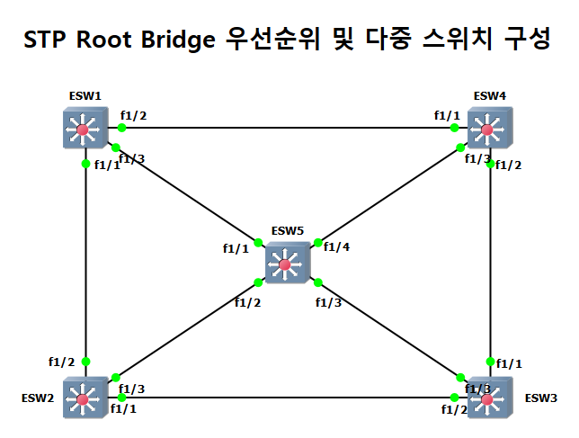
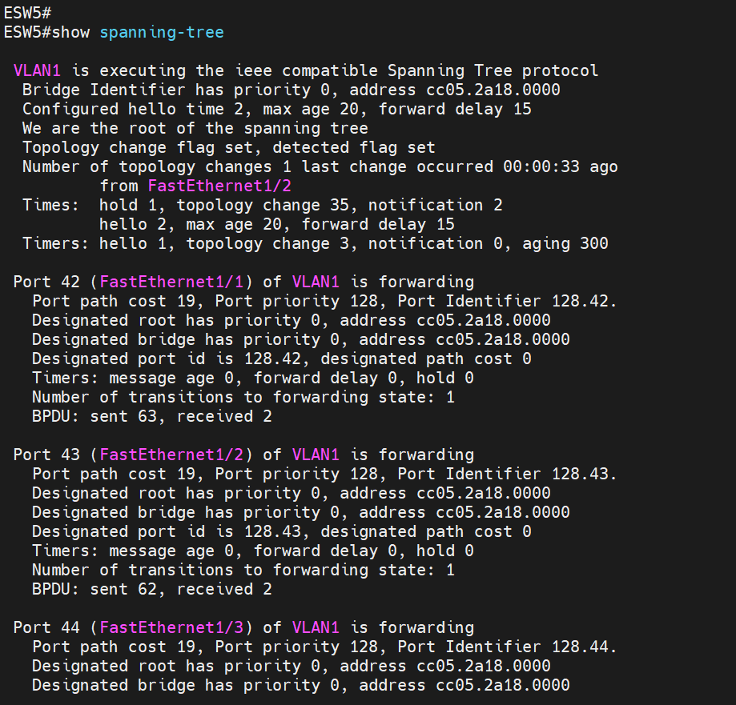

# STP Root Bridge 우선순위 지정

| 항목 | 내용 |
|---|---|
| 프로젝트 | 20260903-2 |
| 실습일 | 2026-09-03 |
| 핵심 기술 | STP(IEEE 802.1D), Root Bridge, 802.1Q Trunk |

스위치 5대를 서로 연결해 순환 구조를 만들고, 한 대의 우선순위를 0으로 지정해 Root Bridge로 선출한 뒤 다른 스위치의 Root Port 선택을 확인한 실습입니다.

## 1. 구성과 목적

NM-16ESW 스위치 모듈 5대(ESW1~ESW5)를 연결했습니다. 바깥쪽 스위치 4대가 사각형을 이루고, 중앙의 ESW5가 각 스위치와 연결되어 있어서 순환 경로가 여러 개 생깁니다. 모든 스위치 간 링크는 802.1Q Trunk입니다. 이 실습의 목적은 순환 구조에서 STP가 어느 스위치를 기준(Root Bridge)으로 삼고, 나머지 스위치가 어떤 포트를 Root Port로 선택하는지 확인하는 것입니다.



## 2. 주요 설정

설정 전체는 [부록 설정 발췌](../부록_설정발췌.md#04-stp-root-bridge-20260903-2)에 수록했습니다. 설정은 ESW5에 한 줄만 추가했습니다.

```
! ESW5
spanning-tree vlan 1 priority 0
```

## 3. 동작 원리

STP는 스위치마다 브리지 ID(우선순위와 MAC 주소)를 비교하여 값이 가장 작은 스위치를 Root Bridge로 선출합니다. 우선순위의 기본값은 32768이므로, 지정하지 않으면 MAC 주소가 가장 작은 스위치가 Root Bridge가 됩니다. ESW5의 우선순위를 0으로 지정하면 MAC 주소와 관계없이 ESW5가 Root Bridge로 고정됩니다.

Root Bridge가 정해지면 나머지 스위치는 Root Bridge에 가장 낮은 비용으로 도달하는 포트를 Root Port로 선택하고, 순환을 만드는 나머지 경로는 차단하여 루프를 막습니다.

## 4. 검증 결과

| 확인 항목 | 장비와 명령어 | 결과 | 증빙 |
|---|---|---|---|
| Root Bridge 선출 | ESW5 `show spanning-tree` | 브리지 우선순위가 0이고 `We are the root of the spanning tree`가 표시됩니다. 확인한 Fa1/1~Fa1/3 포트가 모두 `forwarding` 상태입니다. | [캡처](../assets/evidence/20260903-2/01_ESW5_show-spanning-tree.png) |
| Root Port 선택 | ESW1 `show spanning-tree` | 현재 Root가 `priority 0, address cc05.2a18.0000`(ESW5)으로 표시되고, Root Port는 FastEthernet1/3, Root 경로 비용은 19입니다. | [캡처 1](../assets/evidence/20260903-2/03_ESW1_show-spanning-tree.png), [캡처 2](../assets/evidence/20260903-2/04_ESW1_show-spanning-tree.png) |
| Trunk 상태 | ESW5 `show interfaces trunk` | Fa1/1~Fa1/4가 802.1q로 `trunking`입니다. | [캡처](../assets/evidence/20260903-2/05_ESW5_show-interfaces-trunk.png) |



---

[실습 요약](../실습요약.md) · [설정 발췌](../부록_설정발췌.md#04-stp-root-bridge-20260903-2) · [이 프로젝트의 전체 캡처](../전체증빙/증빙목록.md#20260903-2)
