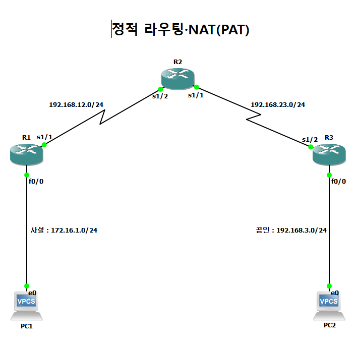
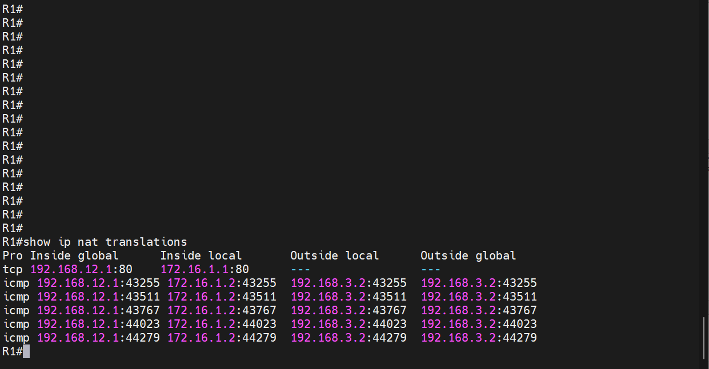
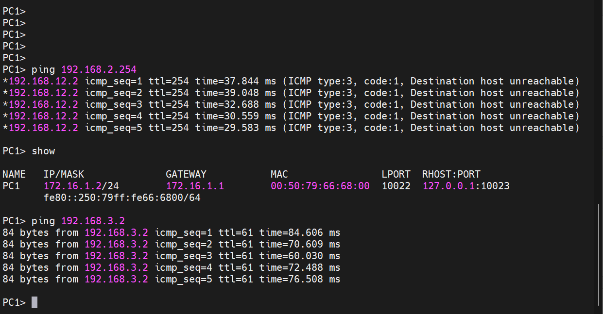
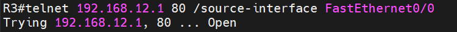
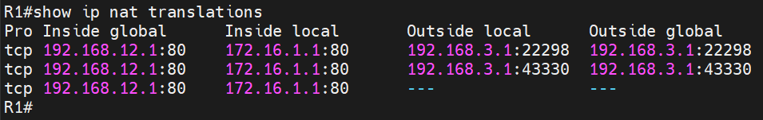

# PAT와 정적 포트 포워딩

| 항목 | 내용 |
|---|---|
| 프로젝트 | 20260825-1 |
| 실습일 | 2026-08-25 |
| 보완 검증일 | 2026-11-09 |
| 핵심 기술 | 정적 라우팅, PAT(NAT overload), 정적 NAT(포트 매핑) |

사설 대역의 PC가 공인 대역으로 통신할 때 출발지 주소를 라우터 외부 인터페이스 주소로 변환(PAT)하고, 외부에서 R1 내부 주소의 TCP 80에 접근할 수 있도록 정적 포트 매핑을 구성한 실습입니다.

## 1. 구성과 목적

R1, R2, R3을 직렬 링크로 연결했습니다. R1 왼쪽의 172.16.1.0/24는 사설 대역(PC1, 172.16.1.2)이고, R3 오른쪽의 192.168.3.0/24는 공인으로 가정한 대역(PC2, 192.168.3.2)입니다. 목적은 두 가지입니다. 첫째, 사설 대역의 여러 호스트가 R1 외부 주소 하나를 공유하여 외부와 통신하게 합니다(PAT). 둘째, 외부에서 R1의 공인 주소 TCP 80으로 들어오는 요청이 사설 주소의 웹 서비스로 전달되도록 합니다(정적 포트 포워딩).



## 2. 주요 설정

설정 전체는 [부록 설정 발췌](../부록_설정발췌.md#05-pat와-정적-포트-포워딩-20260825-1)에 수록했습니다. 계정과 enable 암호 관련 줄은 발췌에서 제외했습니다.

```
! R1
interface FastEthernet0/0
 ip address 172.16.1.1 255.255.255.0
 ip nat inside
interface Serial1/1
 ip address 192.168.12.1 255.255.255.0
 ip nat outside
ip route 0.0.0.0 0.0.0.0 Serial1/1
ip nat inside source list PAT interface Serial1/1 overload
ip nat inside source static tcp 172.16.1.1 80 192.168.12.1 80 extendable
ip access-list standard PAT
 permit 172.16.1.0 0.0.0.255

! R2 (정적 경로)
ip route 172.16.1.0 255.255.255.0 192.168.12.1
ip route 192.168.3.0 255.255.255.0 192.168.23.2

! R3
ip route 0.0.0.0 0.0.0.0 192.168.23.1
```

## 3. 동작 원리

PAT(Port Address Translation)는 내부 호스트의 출발지 주소와 포트(ICMP는 식별자)를 외부 인터페이스 주소와 새 포트로 바꾸어, 주소 하나로 여러 호스트가 외부와 통신하게 합니다. 변환 대상은 ACL `PAT`(172.16.1.0/24)로 지정했고, 이 ACL은 변환할 트래픽을 고르는 용도이며 트래픽을 차단하는 정책이 아닙니다.

정적 포트 포워딩은 `ip nat inside source static tcp`로 외부 주소의 TCP 80과 내부 주소의 TCP 80을 고정 대응시킵니다. 변환 표에 항상 남아 있으며, 외부에서 먼저 시작한 요청도 내부로 전달할 수 있습니다.

R2와 R3에는 정적 경로를 구성하여 두 대역 사이의 전달 경로를 만들었습니다. 사설 대역에서 나간 패킷은 R1에서 출발지 주소가 192.168.12.1로 바뀌므로, 응답은 이 주소를 목적지로 R1에 돌아옵니다.

## 4. 검증 결과

| 확인 항목 | 장비와 명령어 | 결과 | 증빙 |
|---|---|---|---|
| 내부에서 외부 통신 | PC1 `ping 192.168.3.2` | 5개 모두 응답했습니다(ttl=61). | [캡처](../assets/evidence/20260825-1/14_PC1_ping-192-168-3-2.png) |
| PAT 변환 표 | R1 `show ip nat translations` | ICMP 항목에서 Inside local `172.16.1.2`가 Inside global `192.168.12.1`로 변환되었고, Outside는 `192.168.3.2`입니다. | [캡처](../assets/evidence/20260825-1/04_R1_show-ip-nat-translations.png) |
| 정적 포트 매핑 | R1 `show ip nat translations` | `tcp 192.168.12.1:80 ↔ 172.16.1.1:80` 항목이 고정으로 존재합니다. | [캡처](../assets/evidence/20260825-1/03_R1_show-ip-nat-translations.png) |
| ACL | R1 `show access-lists` | 표준 ACL `PAT`가 172.16.1.0/24를 허용합니다. | [캡처](../assets/evidence/20260825-1/05_R1_show-access-lists.png) |





### 보완 검증

R3에서 출발지 인터페이스 FastEthernet0/0(192.168.3.1)을 지정해 R1 외부 주소 192.168.12.1의 TCP 80에 접속했습니다. 연결이 열린 상태에서 R1의 NAT 변환표에 내부 주소 172.16.1.1:80과 외부 접속 주소 192.168.3.1이 같은 TCP 행에 표시됐습니다.





---

[실습 요약](../실습요약.md) · [설정 발췌](../부록_설정발췌.md#05-pat와-정적-포트-포워딩-20260825-1) · [이 프로젝트의 전체 캡처](../전체증빙/증빙목록.md#20260825-1)
