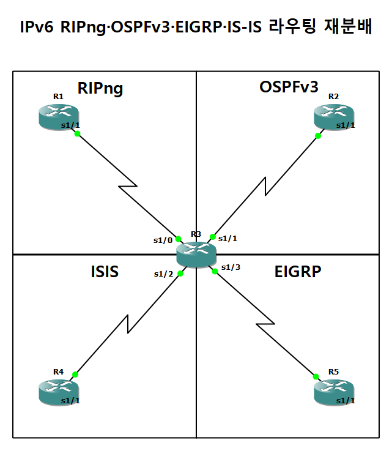
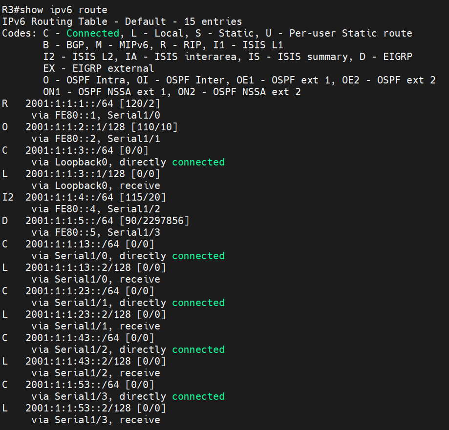

# IPv6 RIPng·OSPFv3·EIGRP·IS-IS 재분배

| 항목 | 내용 |
|---|---|
| 프로젝트 | 20261020-1 |
| 실습일 | 2026-10-20 |
| 핵심 기술 | IPv6, RIPng, OSPFv3, EIGRP for IPv6, IS-IS(IPv6), 경로 재분배 |

라우터 한 대(R3)에 RIPng, OSPFv3, EIGRP for IPv6, IS-IS 네 가지 구간을 연결하고, R3에서 모든 프로토콜 사이의 경로 재분배를 구성하여 구간 간 IPv6 통신을 확인한 실습입니다.

## 1. 구성과 목적

중앙의 R3에 네 방향의 라우터가 직렬 링크로 연결되어 있습니다.

| 방향 | 라우터 | 프로토콜 | 링크 |
|---|---|---|---|
| 위쪽 왼쪽 | R1 | RIPng | 2001:1:1:13::/64 |
| 위쪽 오른쪽 | R2 | OSPFv3 | 2001:1:1:23::/64 |
| 아래쪽 왼쪽 | R4 | IS-IS | 2001:1:1:43::/64 |
| 아래쪽 오른쪽 | R5 | EIGRP for IPv6 | 2001:1:1:53::/64 |

R3은 네 프로토콜을 모두 실행하는 경계 라우터이며, 각 프로토콜이 학습한 경로를 나머지 세 프로토콜로 재분배합니다. 목적은 서로 다른 IPv6 라우팅 프로토콜 구간을 한 라우터에서 연결할 때 실제로 어떤 경로가 어떤 방식으로 학습되는지 확인하는 것입니다.



## 2. 주요 설정

설정 전체는 [부록 설정 발췌](../부록_설정발췌.md#06-ipv6-다중-프로토콜-재분배-20261020-1)에 수록했습니다.

```
! R3
ipv6 router eigrp 100
 redistribute rip 100 metric 1544 20000 255 255 1500 include-connected
 redistribute ospf 100 metric 1544 20000 255 255 1500 include-connected
 redistribute isis metric 1544 20000 255 255 1500 level-1-2 include-connected
ipv6 router ospf 100
 redistribute rip 100 include-connected
 redistribute isis level-1-2 include-connected
 redistribute eigrp 100 include-connected
ipv6 router rip 100
 redistribute ospf 100 metric 10 include-connected
 redistribute isis metric 10 level-1-2 include-connected
 redistribute eigrp 100 metric 10 include-connected
```

## 3. 동작 원리

IPv6의 경로 재분배는 IPv4와 같은 원리이지만 명령어 형식이 다릅니다. 프로토콜 프로세스를 `ipv6 router ...`로 시작하고, 인터페이스에는 `ipv6 rip 100 enable`, `ipv6 ospf 100 area 0`, `ipv6 eigrp 100`, `ipv6 router isis`처럼 프로토콜별로 명시합니다. `include-connected` 옵션은 재분배하는 프로토콜의 인터페이스에 직접 연결된 대역도 함께 광고하도록 합니다.

IS-IS는 IPv4와 IPv6 라우팅을 하나의 프로세스에서 처리하므로 `net` 주소(NET)를 지정해야 하고, 링크 로컬 주소는 라우터마다 `FE80::<번호>`로 지정했습니다.

## 4. 검증 결과

| 확인 항목 | 장비와 명령어 | 결과 | 증빙 |
|---|---|---|---|
| OSPFv3 인접 관계 | R3 `show ipv6 ospf neighbor` | OSPFv3 인접 관계 출력을 수록했습니다. | [캡처](../assets/evidence/20261020-1/03_R3_show-ipv6-ospf-neighbor.png) |
| EIGRP 인접 관계 | R3 `show ipv6 eigrp neighbors` | EIGRP for IPv6 인접 관계 출력을 수록했습니다. | [캡처](../assets/evidence/20261020-1/04_R3_show-ipv6-eigrp-neighbors.png) |
| IS-IS 인접 관계 | R3 `show isis neighbors` | IS-IS 인접 관계 출력을 수록했습니다. | [캡처](../assets/evidence/20261020-1/05_R3_show-isis-neighbors.png) |
| 경계 라우터 경로 | R3 `show ipv6 route` | RIP(`R` 2001:1:1:1::/64), OSPF(`O` 2001:1:1:2::1/128), IS-IS(`I2` 2001:1:1:4::/64), EIGRP(`D` 2001:1:1:5::/64) 경로를 모두 학습했습니다. | [캡처](../assets/evidence/20261020-1/06_R3_show-ipv6-route.png) |
| 종단 통신 | R1 `ping ipv6 2001:1:1:5::1` | RIPng 구간의 R1에서 EIGRP 구간의 R5 Loopback까지 성공률 100%(5/5)입니다. | [캡처](../assets/evidence/20261020-1/10_R1_ping-ipv6-2001-1-1-5-1.png) |



---

[실습 요약](../실습요약.md) · [설정 발췌](../부록_설정발췌.md#06-ipv6-다중-프로토콜-재분배-20261020-1) · [이 프로젝트의 전체 캡처](../전체증빙/증빙목록.md#20261020-1)
