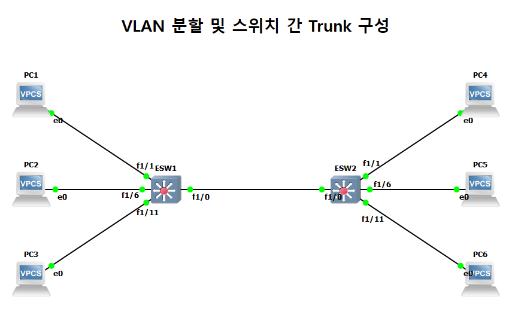
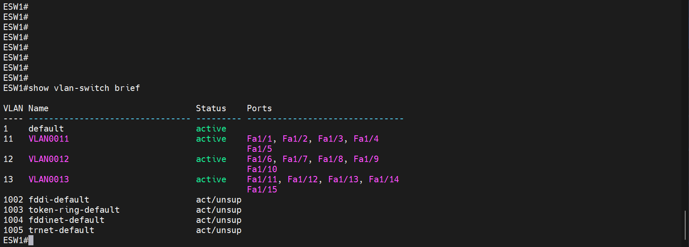
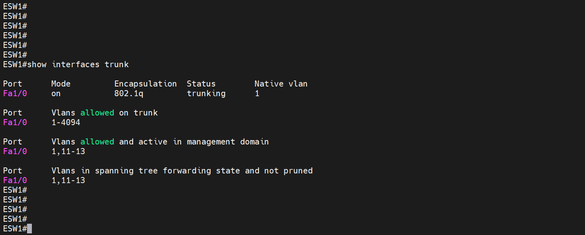

# VLAN 분할과 스위치 간 Trunk

| 항목 | 내용 |
|---|---|
| 프로젝트 | 20260902-1 |
| 실습일 | 2026-09-02 |
| 핵심 기술 | VLAN, 802.1Q Trunk, 스위치 모듈(NM-16ESW), VPCS |

스위치 2대에 VLAN 11·12·13을 포트 단위로 나누고, 두 스위치를 Trunk로 연결하여 같은 VLAN에 속한 PC가 스위치를 건너서 통신하는지 확인한 실습입니다.

## 1. 구성과 목적

ESW1과 ESW2를 Fa1/0 포트로 연결했습니다. 각 스위치에는 PC가 세 대씩 있으며, 포트 번호에 따라 VLAN이 나뉩니다.

| VLAN | 포트 | ESW1 PC | ESW2 PC |
|---|---|---|---|
| 11 | Fa1/1 ~ Fa1/5 | PC1 | PC4 |
| 12 | Fa1/6 ~ Fa1/10 | PC2 | PC5 |
| 13 | Fa1/11 ~ Fa1/15 | PC3 | PC6 |

PC의 IP 대역은 VLAN 번호와 같게 `192.168.11.0/24`, `192.168.12.0/24`, `192.168.13.0/24`를 사용했습니다. 목적은 같은 VLAN이면 서로 다른 스위치에 있어도 통신하고, Trunk 한 개로 세 VLAN이 함께 전달되는 것을 확인하는 것입니다.



## 2. 주요 설정

설정 전체는 [부록 설정 발췌](../부록_설정발췌.md#07-vlan-분할과-스위치-간-trunk-20260902-1)에 수록했습니다.

```
! ESW1 (ESW2도 같은 구성)
interface FastEthernet1/0
 switchport mode trunk
interface range FastEthernet1/1 - 5
 switchport access vlan 11
interface range FastEthernet1/6 - 10
 switchport access vlan 12
interface range FastEthernet1/11 - 15
 switchport access vlan 13
```

## 3. 동작 원리

VLAN은 하나의 스위치를 논리적으로 여러 개의 브로드캐스트 도메인으로 나눕니다. Access 포트는 한 VLAN에만 속하고, Trunk 포트는 802.1Q 태그를 붙여 여러 VLAN의 프레임을 한 링크로 전달합니다. Trunk의 Native VLAN은 기본값인 1이며, 태그 없이 전달됩니다.

## 4. 검증 결과

| 확인 항목 | 장비와 명령어 | 결과 | 증빙 |
|---|---|---|---|
| VLAN 생성과 포트 배정 | ESW1 `show vlan-switch brief` | VLAN 11, 12, 13이 active이고 각각 Fa1/1부터 5까지, Fa1/6부터 10까지, Fa1/11부터 15까지 배정되었습니다. | [캡처](../assets/evidence/20260902-1/01_ESW1_show-vlan-switch-brief.png) |
| Trunk 상태 | ESW1 `show interfaces trunk` | Fa1/0이 802.1q로 `trunking`이고, 허용된 VLAN 중 활성 VLAN은 1, 11~13입니다. | [캡처](../assets/evidence/20260902-1/02_ESW1_show-interfaces-trunk.png) |
| Trunk 상태(반대편) | ESW2 `show interfaces trunk` | 반대편 스위치의 Trunk 상태를 확인했습니다. | [캡처](../assets/evidence/20260902-1/03_ESW2_show-interfaces-trunk.png) |
| VLAN 11 통신 | PC1 `ping 192.168.11.2` | 5개 모두 응답했습니다(ttl=64, 약 0.9ms). | [캡처](../assets/evidence/20260902-1/04_PC1_ping-192-168-11-2.png) |
| VLAN 12 통신 | PC2 `ping 192.168.12.2` | 5개 모두 응답했습니다(ttl=64, 약 0.8ms). | [캡처](../assets/evidence/20260902-1/05_PC2_ping-192-168-12-2.png) |
| VLAN 13 통신 | PC3 `ping 192.168.13.2` | 5개 모두 응답했습니다(ttl=64, 약 0.8ms). | [캡처](../assets/evidence/20260902-1/06_PC3_ping-192-168-13-2.png) |





---

[실습 요약](../실습요약.md) · [설정 발췌](../부록_설정발췌.md#07-vlan-분할과-스위치-간-trunk-20260902-1) · [이 프로젝트의 전체 캡처](../전체증빙/증빙목록.md#20260902-1)
