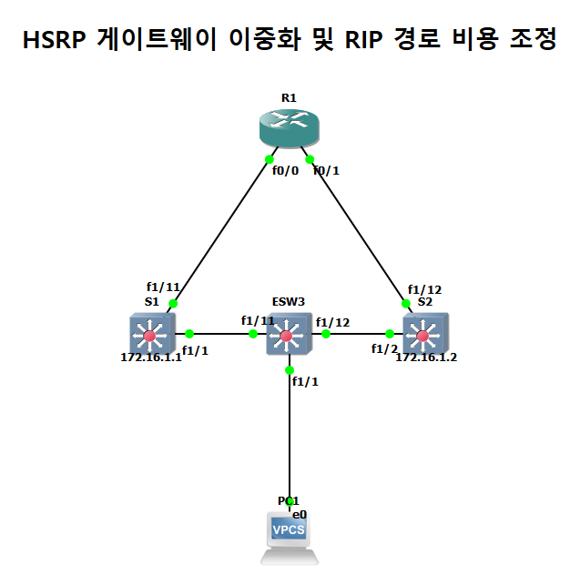
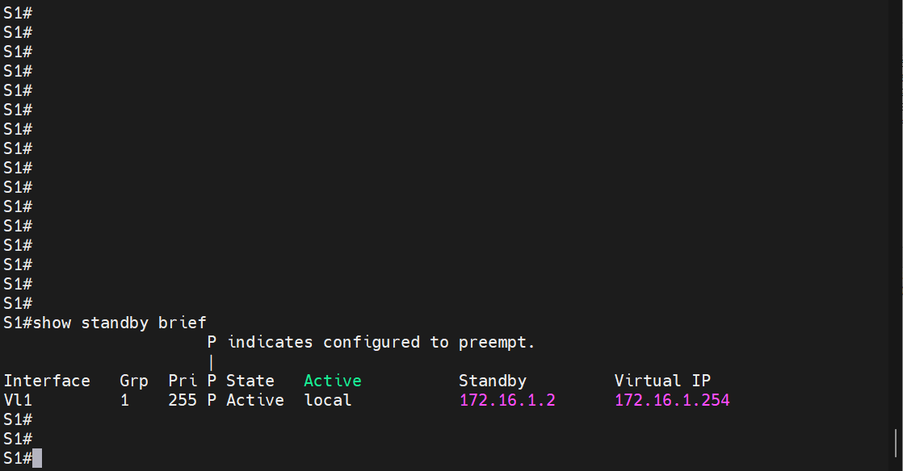
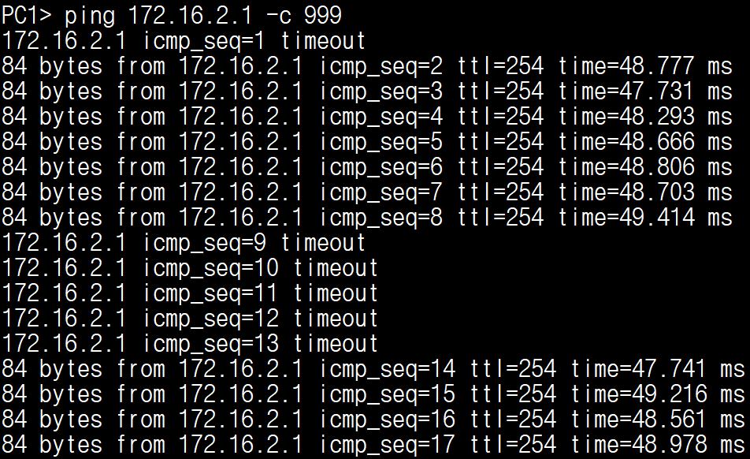

# HSRP 게이트웨이 이중화와 장애 전환

| 항목 | 내용 |
|---|---|
| 프로젝트 | 20260903-5 |
| 실습일 | 2026-09-03 |
| 핵심 기술 | HSRP, 선점(preempt), RIP offset-list, 장애 전환 시험 |

같은 VLAN의 게이트웨이를 스위치 두 대로 이중화하고, 가상 IP로 통신하다가 Active 스위치의 링크를 내렸을 때 Standby가 Active로 전환되고 통신이 복구되는지 확인한 실습입니다.

## 1. 구성과 목적

S1과 S2는 VLAN 1에 SVI(`Vlan1`)를 가진 L3 스위치입니다. 두 스위치는 L2 스위치 ESW3(S1의 Fa1/1, S2의 Fa1/2와 연결)를 통해 같은 VLAN 1을 공유하고, ESW3에 PC1이 연결되어 있습니다. 두 스위치가 HSRP 그룹 1로 가상 IP `172.16.1.254`를 공유하며 PC1은 이 주소를 게이트웨이로 사용합니다. S1(Fa1/11)과 S2(Fa1/12)는 라우팅 포트(`no switchport`)로 R1과 각각 연결되고, RIP으로 172.16.0.0/16 경로를 교환합니다. R1의 Loopback(172.16.2.1)이 PC1의 통신 대상입니다.

목적은 정상 상태에서 한 대가 게이트웨이 역할을 하고, 그 장비가 중단되면 다른 장비가 같은 가상 IP로 역할을 이어받는지 확인하는 것입니다.



## 2. 주요 설정

설정 전체는 [부록 설정 발췌](../부록_설정발췌.md#08-hsrp-게이트웨이-이중화-20260903-5)에 수록했습니다.

```
! S1
interface Vlan1
 ip address 172.16.1.1 255.255.255.0
 standby 1 ip 172.16.1.254
 standby 1 priority 255
 standby 1 preempt

! S2
interface Vlan1
 ip address 172.16.1.2 255.255.255.0
 standby 1 ip 172.16.1.254
 standby 1 priority 0
 standby 1 preempt

! R1 (S2 방향 경로의 비용을 높여 S1 방향을 우선)
router rip
 offset-list 1 in 5 FastEthernet0/1
access-list 1 permit any
```

## 3. 동작 원리

HSRP는 우선순위가 높은 장비를 Active로 선출하고, Active가 응답하지 않으면 Standby가 Active 역할과 가상 IP를 넘겨받습니다. `preempt`를 지정하면 우선순위가 더 높은 장비가 복구되었을 때 Active 역할을 되찾습니다. S1은 우선순위 255, S2는 0으로 설정했으므로 정상 상태에서는 S1이 Active입니다.

R1은 S1 쪽과 S2 쪽 두 경로를 모두 학습하므로, S2 방향(`FastEthernet0/1`)에서 받는 경로에 RIP 비용 5를 더해서 정상 상태에서는 S1 방향으로 트래픽이 가도록 했습니다.

## 4. 검증 결과

| 확인 항목 | 장비와 명령어 | 결과 | 증빙 |
|---|---|---|---|
| 정상 상태(Active) | S1 `show standby brief` | `Vl1  Grp 1  Pri 255  P  Active  local`, Standby는 172.16.1.2, 가상 IP는 172.16.1.254입니다. | [캡처](../assets/evidence/20260903-5/01_S1_show-standby-brief.png) |
| 정상 상태(Standby) | S2 `show standby brief` | `Pri 0  P  Standby`, Active는 172.16.1.1입니다. | [캡처](../assets/evidence/20260903-5/02_S2_show-standby-brief.png) |
| 통신 | PC1 `ping 172.16.1.254`, `ping 172.16.2.1` | 가상 IP와 R1 Loopback 대상 ping 결과를 수록했습니다. | [캡처 1](../assets/evidence/20260903-5/04_PC1_ping-172-16-1-254.png), [캡처 2](../assets/evidence/20260903-5/05_PC1_ping-172-16-2-1.png) |
| 장애 전환 | S1 FastEthernet1/1 `shutdown` | S1의 `Vlan1`이 down이 되고 `Active -> Init`로 바뀝니다. | [캡처](../assets/evidence/20260903-5/08_S1_interface-shutdown-hsrp-log.png) |
| 장애 전환 후 | S2 `show standby brief` | S2가 `Active local`로 전환되었고 Standby는 `unknown`입니다. | [캡처](../assets/evidence/20260903-5/06_S2_show-standby-brief-failover.png) |
| 통신 중단 구간 | PC1 `ping 172.16.2.1 -c 999` | 시험 중 `seq=9`부터 `seq=13`까지 5개가 timeout이고 `seq=14`부터 다시 응답합니다. | [캡처](../assets/evidence/20260903-5/07_PC1_ping-172-16-2-1-continuous-during-failover.png) |
| 복구 후 선점 | S1 `no shutdown`, S2 로그 | S1이 `Standby -> Active`로 복귀하고, S2는 `Active -> Speak -> Standby`로 내려갑니다. | [캡처](../assets/evidence/20260903-5/09_S2_hsrp-state-change-log.png) |





---

[실습 요약](../실습요약.md) · [설정 발췌](../부록_설정발췌.md#08-hsrp-게이트웨이-이중화-20260903-5) · [이 프로젝트의 전체 캡처](../전체증빙/증빙목록.md#20260903-5)
